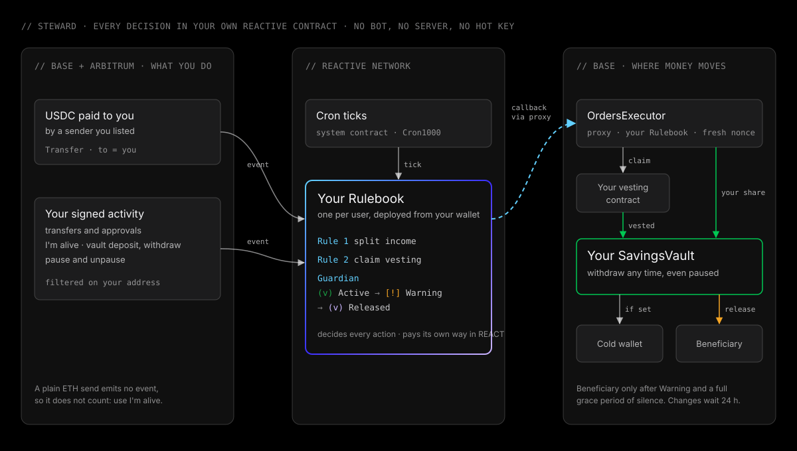

# Steward: a 10-minute check for judges

Steward gives each user one savings vault on Base and three money rules that run themselves. Every decision is made by the user's own `Rulebook` reactive contract on Reactive Network; no bot, server or hot key is involved.

- **The builder's real mainnet vault, live in the app:** [steward-reactive.vercel.app/?watch=0x810fCBF8A695Ffa0e4480207c667995139F33276&net=mainnet](https://steward-reactive.vercel.app/?watch=0x810fCBF8A695Ffa0e4480207c667995139F33276&net=mainnet) (read-only, no wallet needed)
- **App:** https://steward-reactive.vercel.app/ (add [`?preview=active`](https://steward-reactive.vercel.app/?preview=active) for a full dashboard with sample data)
- **Repo:** https://github.com/Alpha-Hackathon-Grinding-Society/steward (MIT)
- **Track:** Set It and Forget It

## 1. Check every claim yourself (one command, no keys)

```bash
git clone https://github.com/Alpha-Hackathon-Grinding-Society/steward.git && cd steward
node scripts/check-live.mjs        # or: make check-live   (Node 18+, nothing to install)
```

For each reactive loop listed in [`scripts/evidence.json`](scripts/evidence.json) (5 on mainnet and 7 on testnet), the script reads the receipts from public RPCs. It checks that:

1. every transaction succeeded;
2. the Reactive transaction carries the Rulebook's own event, and **that event names the origin transaction it reacted to** (`originTxHash` is an indexed topic);
3. the Reactive transaction queues a callback to the executor on the destination chain;
4. the callback was **delivered by Reactive's callback proxy** and emits the executor's event **with the same nonce the Rulebook requested**.

It then reads the mainnet vault and Rulebook as they are now: balance, Guardian state, REACT left, debt. It exits non-zero if any check fails. The last run (2026-11-26) ended with `All checks passed.` after 68 checks.

## 2. Mainnet: the builder's own vault, on real income

The user's wallet set Steward up from the app and signed every step. The vault has run since **2026-11-26 01:58 UTC**; the day-by-day log is in [docs/MAINNET_USAGE.md](docs/MAINNET_USAGE.md).

| What happened | Origin (Base) | Reactive (1597) | Callback (Base) |
| --- | --- | --- | --- |
| Rule 1: 1 USDC paid, 0.20 saved | [0xe98c…cd86](https://basescan.org/tx/0xe98c0af12daabde1f1bc4908d79e452e4ef9d81e2e124adf654034a6d70ccd86) | [0xf32c…8b81](https://reactscan.net/tx/0xf32c83d342bdd748710f03576c23986b8d4dd9bd521729e1e19074b022558b81) | [0x95f8…3eb0](https://basescan.org/tx/0x95f8b3c1e0d4498a2e86b215612d4f69790cd9ce27d7392237e67a96eb383eb0) |
| Rule 1: 0.18 USDC paid, 0.036 saved | [0xc148…0925](https://basescan.org/tx/0xc148e0f4084b8ec28066dd0af587e3a4d47e4e9f40f0b279ed6f8e87c1ea0925) | [0xfd3a…45fb](https://reactscan.net/tx/0xfd3a3206cc94e2f4c2a089a2a121fb246c566232c1f7357a191f0611a4f745fb) | [0xf9b9…7b0f](https://basescan.org/tx/0xf9b9812bf9c873d8093044727cd483c77ed381fb05026c3454b6bd4ffbb67b0f) |
| Guardian: I'm alive resets the clock | [0x7f09…5696](https://basescan.org/tx/0x7f090f8fe730f4bb4d90c18eb3c06807708ec5ad503d3c674f9f4bf4257d5696) | [0xeac1…4a42](https://reactscan.net/tx/0xeac133f9259ae9abfc3fb37c019b1927f1823e7c1e042dd80fe619c2722f4a42) | none needed |
| Guardian: a signed action on **Arbitrum** (second chain) | [0xd638…84a4](https://arbiscan.io/tx/0xd63845c299bf3023c0a571ba914fbc89eb9d6f22331d921b09be306e1e2e84a4) (Arbitrum) | [0x8d99…1401](https://reactscan.net/tx/0x8d99bf34e30adb81882d6a6e472a3fbd982169aa61197d8cd05414a20c181401) | none needed |
| Rule 1 ignored a look-alike sender (an address-poisoning attempt) | `0x9b0f…b960` (named in the event) | [0xf354…c7b9](https://reactscan.net/tx/0xf354c11354e969143e7d550397dea80a36d0911e74ca4a5aed8391c65ff9c7b9) | none, by design |

**Speed.** From the moment a payment lands to the moment the share sits in the vault takes **7–8 Base blocks, about 1.5 seconds** on mainnet and 8–10 blocks (about 2 seconds) on testnet. Base makes a block every 0.2 s. The full table, measured from block timestamps, is printed by the script.

**What it costs to run.** Measured on mainnet: the Rulebook spends about **1.3 REACT a day** on quiet days (about **$0.003 a day**), and each automatic split costs the executor about **0.0000011 ETH** of Base gas (about **$0.002**). Prices from 2026-11-26: REACT $0.0020, ETH $1,698. You pay no gas yourself for anything Steward does.

**Verified source.** Every mainnet contract is verified on Sourcify with an **exact match** (same source, compiler settings and metadata):

| Contract | Network | Address | Source |
| --- | --- | --- | --- |
| VaultFactory | Base | `0x4461142Af87f775242Ff27B0aBB7Ac8b7BFA9686` | [Sourcify](https://repo.sourcify.dev/8453/0x4461142Af87f775242Ff27B0aBB7Ac8b7BFA9686) |
| OrdersExecutor | Base | `0xEaA3CB8cdE5d079CC6da775d21517F7770712036` | [Sourcify](https://repo.sourcify.dev/8453/0xEaA3CB8cdE5d079CC6da775d21517F7770712036) |
| Heartbeat | Base | `0xFBD66e0C9Db8dA83C45c38AB859D12C228AC6447` | [Sourcify](https://repo.sourcify.dev/8453/0xFBD66e0C9Db8dA83C45c38AB859D12C228AC6447) |
| SavingsVault (the builder's) | Base | `0xD5f071D9e4E32a2f4004742AFFD77C127f14Dc75` | [Sourcify](https://repo.sourcify.dev/8453/0xD5f071D9e4E32a2f4004742AFFD77C127f14Dc75) |
| Rulebook (the builder's) | Reactive | `0x90104E9200e95D46E85c2Bdb14d223A60Ec5D31a` | [Sourcify](https://repo.sourcify.dev/1597/0x90104E9200e95D46E85c2Bdb14d223A60Ec5D31a) |

## 3. Testnet: all three rules, including the Guardian's full cycle

Every rule has an origin, Reactive and callback hash in the [README](README.md#on-chain-evidence) and in [docs/TX_HASHES.md](docs/TX_HASHES.md). These are the ones that matter most:

- **Rule 2 claim** on a cron tick: [Lasna 0x4a62…5129](https://lasna.reactscan.net/tx/0x4a62e41b6ec1aeeff33aaf9fa633127397bea829411f9ac3a711edd13ae65129) → [Base Sepolia 0xabf2…3ce4](https://sepolia.basescan.org/tx/0xabf27e8ec64fd6ba9cedcf05a4a266196f7ad7428d632da1eb0d8ba7a6783ce4) (a real OpenZeppelin `VestingWallet`)
- **Guardian Warning** after silence: [0xb2b4…9c15](https://lasna.reactscan.net/tx/0xb2b49600f03332ccb5bbeb508ac508f0492ec7e6420f61232a955f3d00819c15)
- **Warning cleared** by activity on a *second chain* (Unichain Sepolia): [0xf73c…076f](https://sepolia.uniscan.xyz/tx/0xf73cdb6848b4ec58c7d1ac358c39d6b7a3f1e4a351455969e3a0a6dc0d2d076f) → [0xe86e…9642](https://lasna.reactscan.net/tx/0xe86ee39820192c3b5fdba3bc578d4750f43b7c53ed27b019115dbb317c1f9642)
- **Release to the beneficiary** after the full grace period: [0xdf94…46da](https://lasna.reactscan.net/tx/0xdf94be3488bbe60d96c4c8e5f94a2861424328b3bc27fc53afa2b2dda6b746da) → [0x0e9f…99a2](https://sepolia.basescan.org/tx/0x0e9f2cc81682c7334946b566767b109f02f463c873763be4b4f69b3ab31c99a2)

## 4. Where each judging criterion is shown




| Criterion | Where to look |
| --- | --- |
| **Execution** | The check script above; [docs/TX_HASHES.md](docs/TX_HASHES.md) (every run since Phase 1, including 68 recorded cron ticks); [docs/MAINNET_USAGE.md](docs/MAINNET_USAGE.md) |
| **Integration** | One `Rulebook` per user ([contracts/src/Rulebook.sol](contracts/src/Rulebook.sol)) subscribes to two origin chains (Base and Arbitrum on mainnet, Base Sepolia and Unichain Sepolia on testnet) plus Reactive's cron, always filtered on the user's address; Guardian activity uses the contract wildcard. It sends three kinds of callback (split, claim, release), offers a public `checkNow()` fallback if cron is late, and pays its own way with `coverDebt()`. Every Reactive API used is written down with file and line references into `reactive-lib-omni` in [docs/NOTES.md](docs/NOTES.md). |
| **Usefulness** | A real vault on Base mainnet saving from real income; three rules people actually need (pay yourself first, claim vesting, a dead-man's switch); setup is one page with plain-language fields, and a wallet signs it in two networks |
| **Craft** | 124 Foundry tests: unit tests named after PRD requirement IDs, fuzz tests, and an invariant suite of 1,000 runs × 50 steps for the seven safety limits. 71 unit tests and 13 browser tests (run at desktop and phone sizes) for the app. Slither triaged in [docs/SECURITY.md](docs/SECURITY.md). Design system in [docs/DESIGN.md](docs/DESIGN.md). |

## 5. Safety limits, in plain words

Funds can reach only three places: the user's vault, their cold wallet (through the vault), or their beneficiary after Warning **and** a full grace period. The executor accepts a call only from Reactive's callback proxy, only from the Rulebook that user registered, and only with a fresh nonce. The owner can always withdraw, even while paused. A beneficiary or cold-wallet change waits 24 hours. Automated moves never count as the user being alive. All seven limits and their tests are in the [README](README.md#safety-limits).

## 6. Try it yourself on testnet (about 10 minutes)

You need a browser wallet (MetaMask or similar) with a little **Base Sepolia ETH** (from any Base Sepolia faucet) and about **1 lREACT** on Lasna.

1. **Get lREACT.** From your wallet, send **0.01 Base Sepolia ETH** to Reactive's faucet contract `0x2afaFD298b23b62760711756088F75B7409f5967` on Base Sepolia. About 1 lREACT arrives on Lasna (chain 5318007) within a minute. Never send more than 5 ETH in one go.
2. **Open** https://steward-reactive.vercel.app/, choose **Testnet**, and connect.
3. **Set up your rules.** For *who pays you*, use a second address you control. Pick a share (for example 20%). Leave the Guardian on, then add a beneficiary address.
4. **Sign** the USDC permit and `createVault` on Base Sepolia. Then let the page switch you to Lasna and sign the Rulebook deploy (it attaches 0.5 lREACT). Each signature moves from `(~) PENDING` to `(v) SUCCESS` with its explorer link.
5. **Pay yourself test USDC from the second address.** Test USDC is `0x12E627587Ef1d653014AE6ABf9759DB2Ee5C1F2a` on Base Sepolia, and anyone can mint it (it's [verified](https://repo.sourcify.dev/84532/0x12E627587Ef1d653014AE6ABf9759DB2Ee5C1F2a)). From the second address, call `mint(<second address>, 10000000)` for 10 USDC on [Blockscout's Write tab](https://base-sepolia.blockscout.com/address/0x12E627587Ef1d653014AE6ABf9759DB2Ee5C1F2a?tab=write_contract), then send that USDC to your main address. If you cloned the repo, use `make pay-test-usdc TO_ADDRESS=<your main address>` instead; it does both steps.
6. **Watch** the vault card: your share reaches the vault about 2 seconds after the payment, and the card shows it at its next refresh. Then try **I'm alive**, **Pause all** and **Withdraw**.
