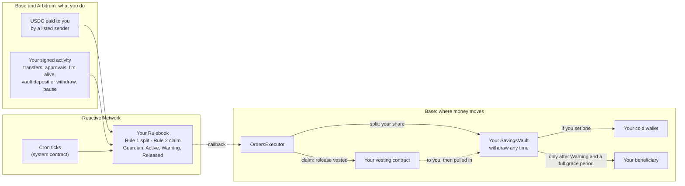

<p align="center"></p>

# Steward

Set your money rules once: a share of every paycheck goes into savings, vested tokens are claimed into your vault, and if you go silent on every chain, your savings reach the person you chose. Every decision runs in your own reactive contract on [Reactive Network](https://reactive.network), with no bot, server or hot key.

> Built for the Reactive Omni Buildathon, Set It and Forget It track. Small, unaudited amounts only. Progress per phase is in [docs/PROGRESS.md](docs/PROGRESS.md).

## Demo video

Coming with the submission.

## On-chain evidence

Each rule action takes three transactions: the event on Base (the origin), your Rulebook reacting on Reactive, and the executor's callback on Base. Every run's hashes, including the Phase 1 loop and cron tests, are in [docs/TX_HASHES.md](docs/TX_HASHES.md).

**Testnet** (Base Sepolia and Unichain Sepolia ↔ Lasna):

| Rule | Network | Origin tx | Reactive tx | Callback tx |
| --- | --- | --- | --- | --- |
| Rule 1 split (listed sender, 20% of 100 USDC) | Base Sepolia → Lasna → Base Sepolia | [0x36a4…0095](https://sepolia.basescan.org/tx/0x36a4200afdf67756bb09d2f24dcfba16862ba0ad182acc5f7c851904dc460095) | [0xda7a…2dc5](https://lasna.reactscan.net/tx/0xda7a63891d09d89812ac5e164a0321437b54f8bcb8fec7fda8660bc2b25a2dc5) | [0x5dfc…53b0](https://sepolia.basescan.org/tx/0x5dfcca7df4f273fcbe0ced13abde6e527b59f9dc3128d37979d79be6e58c53b0) |
| Rule 1 ignored (unlisted sender) | Base Sepolia → Lasna | [0x0c02…9798](https://sepolia.basescan.org/tx/0x0c02b7c6415dd4ed7552102742b145401bb67d7eb3cfe49e60a561842d139798) | [0xce45…0c46](https://lasna.reactscan.net/tx/0xce4582125e24c26069381b96d52de0cab9bbd0b27727d9d7f0f84ef42c890c46) | none, by design |
| Rule 1 split into a vault set up from the app (20% of 10 USDC) | Base Sepolia → Lasna → Base Sepolia | [0x028b…28a1](https://sepolia.basescan.org/tx/0x028b6f771094a4f46e40e2873703a100294b5ac6860827924ce230eb521728a1) | [0x32fc…0136](https://lasna.reactscan.net/tx/0x32fcea5a5b4aae3fe4fb488753c1019fb5ed9cd6228585b6d19feffa88410136) | [0xca46…cc88](https://sepolia.basescan.org/tx/0xca46265c602bfd5021a943acce0c3836f36561718983d082581e190cd33bcc88) |
| Rule 2 claim (vested tokens into the vault) | Lasna cron → Base Sepolia | `Cron10` tick | [0x4a62…5129](https://lasna.reactscan.net/tx/0x4a62e41b6ec1aeeff33aaf9fa633127397bea829411f9ac3a711edd13ae65129) | [0xabf2…3ce4](https://sepolia.basescan.org/tx/0xabf27e8ec64fd6ba9cedcf05a4a266196f7ad7428d632da1eb0d8ba7a6783ce4) |
| Guardian warning after silence | Lasna cron | `Cron10` tick | [0xb2b4…9c15](https://lasna.reactscan.net/tx/0xb2b49600f03332ccb5bbeb508ac508f0492ec7e6420f61232a955f3d00819c15) | none |
| Guardian cleared by activity on a second chain | Unichain Sepolia → Lasna | [0xf73c…076f](https://sepolia.uniscan.xyz/tx/0xf73cdb6848b4ec58c7d1ac358c39d6b7a3f1e4a351455969e3a0a6dc0d2d076f) | [0xe86e…9642](https://lasna.reactscan.net/tx/0xe86ee39820192c3b5fdba3bc578d4750f43b7c53ed27b019115dbb317c1f9642) | none |
| Guardian release to the beneficiary after the grace period | Lasna cron → Base Sepolia | `Cron10` tick | [0xdf94…46da](https://lasna.reactscan.net/tx/0xdf94be3488bbe60d96c4c8e5f94a2861424328b3bc27fc53afa2b2dda6b746da) | [0x0e9f…99a2](https://sepolia.basescan.org/tx/0x0e9f2cc81682c7334946b566767b109f02f463c873763be4b4f69b3ab31c99a2) |

**Mainnet** (Base and Arbitrum ↔ Reactive): the first real split and the Guardian's first checks will be recorded here once the mainnet vault is live.

## Mainnet usage

The builder's own Steward vault on Base mainnet, running Rule 1 and the Guardian on real income. Its days running, total saved, REACT spent per day and every rule action will be logged in `docs/MAINNET_USAGE.md` once it starts.

## Architecture

Each user has their own `Rulebook` on Reactive and their own `SavingsVault` on Base. The Rulebook decides every action; the executor and the vault only carry it out.



| Contract | Network | Role |
| --- | --- | --- |
| `Rulebook` | Reactive | One per user, deployed from their own wallet. Subscribes to their events and to cron, holds the rules and Guardian state, and sends every callback. |
| `OrdersExecutor` | Base | Accepts a callback only from the Reactive callback proxy, only from the Rulebook the user registered, only with an unused nonce, and only while the user isn't paused. Holds each user's pause switch. |
| `SavingsVault` | Base | One per user. The owner can deposit and withdraw at any time. The beneficiary and cold wallet change only after 24 hours. Only the executor can forward a claim or release the vault. |
| `VaultFactory` | Base | Creates each vault at an address known in advance (CREATE2), applies the user's USDC permit and registers their Rulebook, all in one transaction. |
| `Heartbeat` | Base | Emits `Alive(user)` when you press I'm alive. |

The exact Reactive APIs used, with file and line references into `reactive-lib-omni`, are in [docs/NOTES.md](docs/NOTES.md).

## Safety limits

Steward moves your own money without asking each time, so these limits are enforced in the contracts and checked by an invariant test suite (1,000 random runs × 50 steps, all seven holding):

1. **Money goes only to three places:** your vault, your cold wallet (through the vault), or your beneficiary after a full Guardian cycle. No other address is possible.
2. **A release never happens in one step.** The Guardian must first warn, then wait a full grace period with no activity from you.
3. **Rule 1 stays within its limits:** never more than the per-period cap, and never more than the total you signed in the USDC permit.
4. **Only your Rulebook can instruct the executor:** calls must come from the Reactive callback proxy, carry your registered Rulebook's address, and use a fresh nonce.
5. **You can always withdraw,** including while paused or in Warning.
6. **Only what you sign counts as activity.** Steward's own moves into your vault and vesting releases never reset the Guardian clock.
7. **Changing your beneficiary or cold wallet takes 24 hours,** so a stolen key can't redirect your vault instantly.

Also worth knowing:

- A plain ETH send emits no event, so it doesn't count as activity. Use I'm alive (`make alive`, or the button in the app).
- While you're paused, a due release waits. Unpausing counts as activity, so it returns the Guardian to Active.
- If your Rulebook runs out of REACT, every rule stops, the Guardian included. Your savings stay in your vault, and you can still withdraw. Top it up to resume.
- Slither results and the reasoning behind each one are in [docs/SECURITY.md](docs/SECURITY.md). The contracts are not audited, so keep amounts small.

## How to run

```bash
git clone --recurse-submodules https://github.com/Alpha-Hackathon-Grinding-Society/steward.git
cd steward
make install   # pinned submodules (if you cloned without --recurse-submodules)
make test      # unit, fuzz and invariant tests
make help      # every build, deploy and e2e target
```

Requires [Foundry](https://getfoundry.sh) v1.9.0+ and Node.js (the e2e runners use it to read JSON). Copy `.env.example` to `.env` and fill in `PRIVATE_KEY` before any deploy.

**Deploy, one command per network** (each writes its addresses to `contracts/deployments/<network>.json`):

| Network | Shared contracts (Base side) | Your Rulebook (Reactive side) |
| --- | --- | --- |
| Testnet | `make deploy-base-sepolia` | `make deploy-rulebook-lasna`, then `make create-vault-base-sepolia` |
| Mainnet | `make deploy-base` | `make deploy-rulebook-reactive`, then create the vault from the app |

Mainnet targets refuse to run unless `STEWARD_MAINNET_APPROVED=true` is set. Deploy the Rulebook before the vault, so the vault can register it. Set `INCOME_SENDERS` and `BENEFICIARY` in `.env` first.

**Rule 1 on testnet** (needs Base Sepolia ETH and lREACT on one wallet):

```bash
make deploy-base-sepolia   # VaultFactory + OrdersExecutor + Heartbeat + MockUSDC
make e2e-rule1             # employers, your Rulebook on Lasna, your vault, two payments; prints every tx hash
```

**Rule 2 and the Guardian on testnet** (demo timers; also needs a little Unichain Sepolia ETH):

```bash
make deploy-base-sepolia
BENEFICIARY=0x... make e2e-phase3   # claim, warning, clear from Unichain, warning, grace, release (~12 min)
```

**Everyday actions**, one command each (add `NET=base` or `NET=reactive` for mainnet):

| Command | What it does |
| --- | --- |
| `make alive` | I'm alive: resets the Guardian clock and clears a Warning |
| `make pause` / `make unpause` | Stops or resumes every rule; withdrawing still works |
| `make withdraw` | Moves savings from your vault back to your wallet |
| `make propose-beneficiary` / `make apply-beneficiary` | Changes your beneficiary, applied after 24 hours |
| `make propose-cold-wallet` / `make apply-cold-wallet` | Sends future claims on to a cold wallet, applied after 24 hours |
| `make edit-rules` | Changes Rule 1's share, cap and income senders |
| `make top-up-react` | Sends REACT to your Rulebook and pays off any debt |
| `make withdraw-react` | Sends the REACT left in your Rulebook back to you (after a release, or to retire it) |
| `make check-now` | Advances the Guardian by the clock if cron is late |
| `make status` | Prints your Guardian state, clocks and REACT balance |

**Keeping your Rulebook running.** Your Rulebook pays for its own work in REACT (lREACT on Lasna): about 0.012 per cron tick or event it handles, plus each callback. A quiet day on `Cron1000` costs about 1 REACT. If the balance runs out, the network records a debt and stops delivering events until it's paid. `make top-up-react` (`TOP_UP_WEI`, default 1) sends REACT and calls `coverDebt()` in one go. Anyone can call `coverDebt()` once there's enough balance. The app shows `[!] LOW REACT` below about a day's cost on testnet (three on mainnet), and `OUT OF REACT` when there's debt.

**The app** (one page in `web/`: set up a vault, see the Guardian count down, I'm alive, pause, withdraw). Needs Node.js 22+ and pnpm 10:

```bash
make web-install   # pnpm install
make web-dev       # http://localhost:3000
make web-sync      # after a contract change or deploy: refresh web/lib/generated (addresses + Rulebook bytecode)
make web-check     # lint, typecheck, format check, unit tests
make web-e2e       # Playwright smoke test (desktop + phone sizes)
```

Add `?preview=active` (or `warning`, `released`, `paused`, `lowreact`, `novault`) to the URL to see each state with labelled sample data and no wallet. A phone wallet on the same Wi-Fi can open the app at `http://<your PC's LAN address>:3000` in its built-in browser; add that address to `allowedDevOrigins` in `web/next.config.ts`. WalletConnect is optional: set `NEXT_PUBLIC_WALLETCONNECT_PROJECT_ID` in `web/.env.local`.

## Deployed addresses

**Base Sepolia** (`contracts/deployments/base-sepolia.json`):

| Contract | Address |
| --- | --- |
| VaultFactory | [`0x207feeecD8b2f6F479be2Ed591F309F06501F0cc`](https://sepolia.basescan.org/address/0x207feeecD8b2f6F479be2Ed591F309F06501F0cc) |
| OrdersExecutor | [`0x12B9D62B13e626163114588DCBa51C6a7B88CCEC`](https://sepolia.basescan.org/address/0x12B9D62B13e626163114588DCBa51C6a7B88CCEC) |
| Heartbeat | [`0xe6847bA8f223c74f64f8C317dB5a40A848740EA8`](https://sepolia.basescan.org/address/0xe6847bA8f223c74f64f8C317dB5a40A848740EA8) |
| MockUSDC (with permit) | [`0x12E627587Ef1d653014AE6ABf9759DB2Ee5C1F2a`](https://sepolia.basescan.org/address/0x12E627587Ef1d653014AE6ABf9759DB2Ee5C1F2a) |
| Callback proxy (Reactive) | `0x476F44b11F5C942c58f4c8E3d0300E5710743585` |

**Lasna**: each user has their own Rulebook. The one set up from the app in the test above is [`0x80e7C5958626daAE7e5Be8A99F2E30B2226c7F74`](https://lasna.reactscan.net/address/0x80e7C5958626daAE7e5Be8A99F2E30B2226c7F74), and its vault is [`0xCe5c02d6cEb2340929F00Ef4D2a418DE9cccfC73`](https://sepolia.basescan.org/address/0xCe5c02d6cEb2340929F00Ef4D2a418DE9cccfC73).

**Base and Reactive mainnet**: coming soon (`contracts/deployments/base.json`).

## Docs

- [Product requirements](docs/PRD.md)
- [Design system](docs/DESIGN.md)
- [Reactive integration notes](docs/NOTES.md): exact APIs, live measurements, design decisions
- [Security notes](docs/SECURITY.md): Slither triage, trust assumptions, known limits
- [Transaction hashes](docs/TX_HASHES.md)

## License

[MIT](LICENSE)
