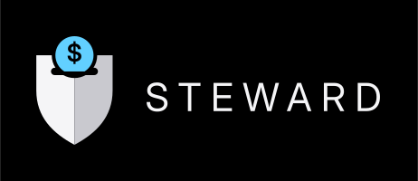

<p align="center"></p>

# Steward

Set your money rules once: income gets split into savings, vested tokens get claimed into your vault, and if you go silent on every chain, your savings reach the person you chose. Every decision runs in your own reactive contract on [Reactive Network](https://reactive.network), with no bot, server or hot key.

> Work in progress for the Reactive Omni Buildathon (Set It and Forget It track). Demo video, tx hashes and mainnet usage land here as each phase passes; see [docs/PROGRESS.md](docs/PROGRESS.md).

## How to run

```bash
git clone --recurse-submodules https://github.com/Alpha-Hackathon-Grinding-Society/standing-orders.git
cd standing-orders
make install   # pinned submodules (if you cloned without --recurse-submodules)
make test      # forge test in contracts/
make help      # every build, deploy and e2e target
```

Requires [Foundry](https://getfoundry.sh) v1.9.0+. Copy `.env.example` to `.env` before any deploy.

## Docs

- [Product requirements](docs/PRD.md)
- [Design system](docs/DESIGN.md)
- [Reactive integration notes](docs/NOTES.md)

## License

[MIT](LICENSE)
